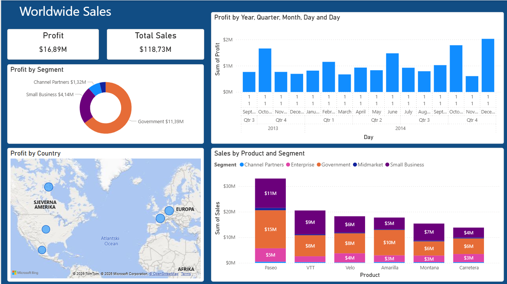
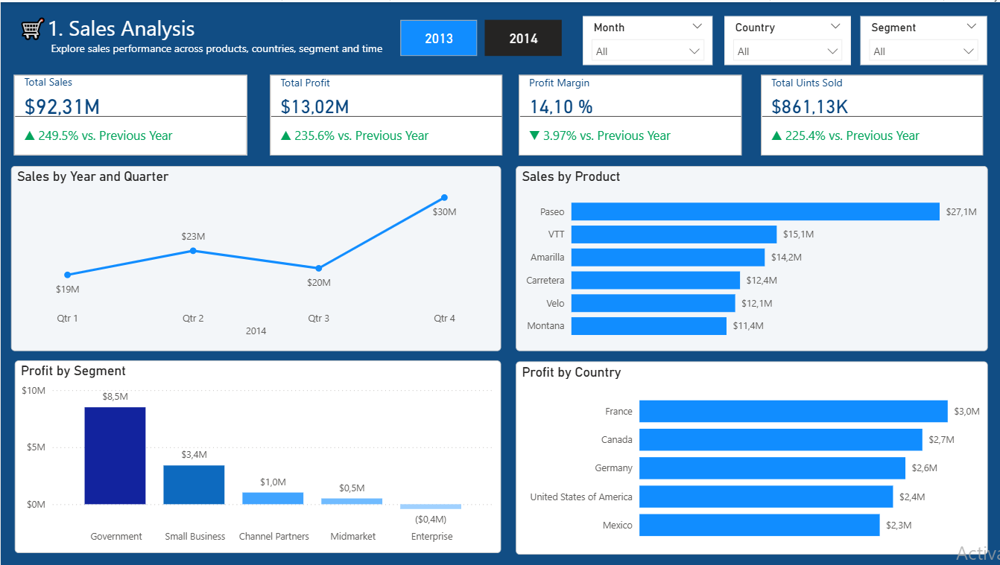
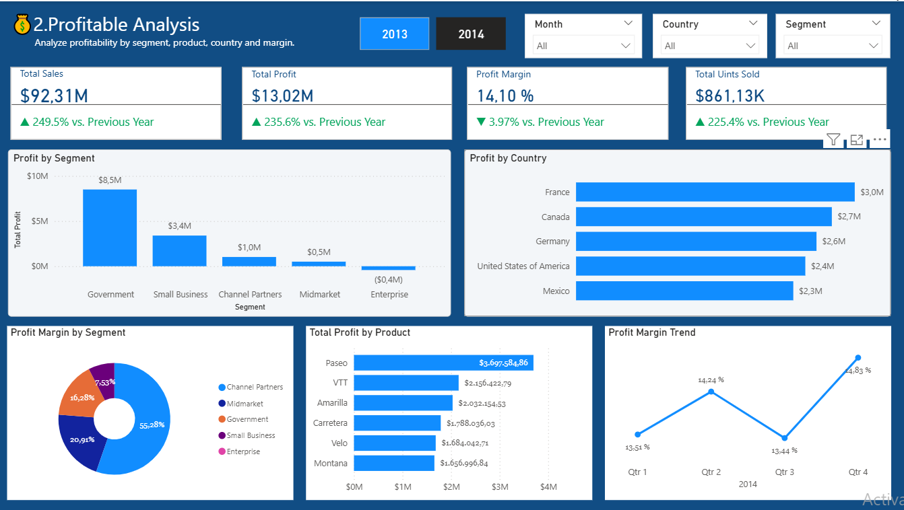
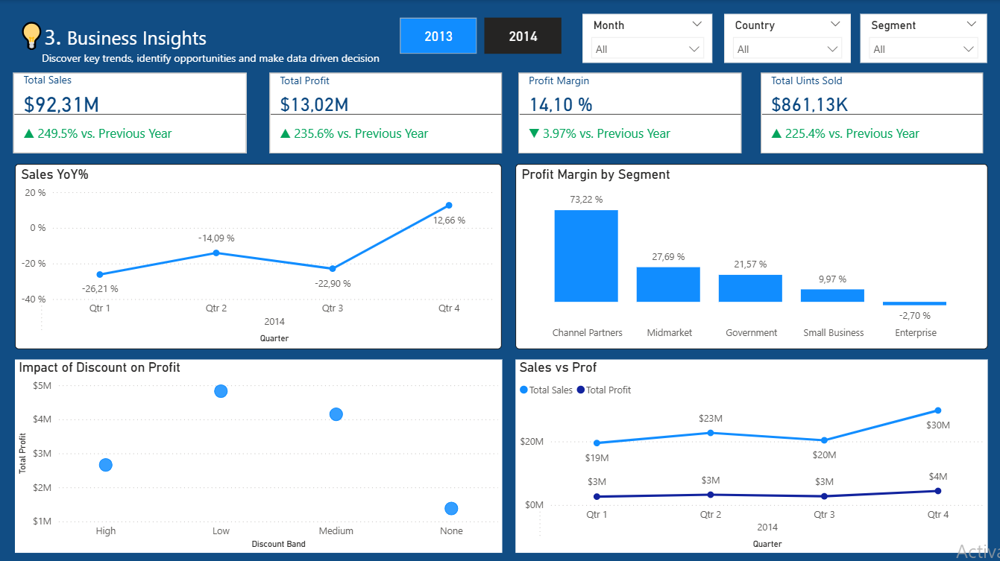

# E-Commerce Sales & Profit Analysis

## Project Overview
An interactive Power BI dashboard analyzing sales performance, profitability, product performance, customer segments, and business trends.

## Tools Used
- Microsoft Power BI
- DAX
- Data Visualization
- Business Intelligence

## Dashboard Pages

### 1. Worldwide Sales
Overview of worldwide sales and profit by segment, country, product, and time.

### 2. Sales Analysis
Analysis of total sales, profit, profit margin, units sold, product performance, and country performance.

### 3. Profitable Analysis
Detailed profitability analysis by segment, country, product, and profit margin trends.

### 4. Business Insights
Analysis of sales year-over-year changes, profit margin by segment, discount impact, and sales versus profit trends.

## Key Business Questions
- Which products generate the highest sales?
- Which customer segments generate the most profit?
- Which countries perform best?
- How does profitability change over time?
- How are discount bands associated with profit?

## Author
Data Analytics Portfolio Project
